
<strong>Italiano</strong> · <a href="user-manual.md">English</a>

# SunTrace 2 — Manuale utente

SunTrace 2 ti dice quanto costerà scaldare la stanza che stai per affittare, in
euro al mese, prima di firmare. Questo manuale segue l'app passo per passo, con
una schermata per ogni passaggio.

**Apri l'app:** <https://holyemilio.github.io/suntrace2/>

1. [A chi serve](#1-a-chi-serve)
2. [Aprire SunTrace 2](#2-aprire-suntrace-2)
3. [La guida alla prima visita](#3-la-guida-alla-prima-visita)
4. [Trovare la casa e disegnare la stanza](#4-trovare-la-casa-e-disegnare-la-stanza)
5. [Leggere la stima](#5-leggere-la-stima)
6. [Rispondere alle domande della visita](#6-rispondere-alle-domande-della-visita)
7. [La checklist e la scheda da condividere](#7-la-checklist-e-la-scheda-da-condividere)
8. [I dettagli tecnici e la mappa](#8-i-dettagli-tecnici-e-la-mappa)
9. [Dal telefono](#9-dal-telefono)
10. [Domande frequenti e problemi comuni](#10-domande-frequenti-e-problemi-comuni)

---

## 1. A chi serve

SunTrace 2 è per chi cerca casa in affitto: studenti, studenti lavoratori,
lavoratori fuori sede. In un minuto ottieni:

- **la cifra più probabile** del riscaldamento al mese, con la forbice tra caso migliore e peggiore;
- **la quota a testa**, se dividi le bollette;
- **quanto ti fa risparmiare il sole** che entra dalle finestre;
- **il confronto con una stufetta elettrica**;
- **cosa controllare e chiedere** alla visita;
- **una scheda da condividere** con i coinquilini.

Ti serve solo un browser, dal computer o dal telefono. Niente installazione,
niente account. Funziona solo in Italia. Se il dispositivo è in modalità
scura, anche l'app lo è.

## 2. Aprire SunTrace 2

La pagina iniziale spiega in breve cosa fa l'app e ha già la barra di ricerca.

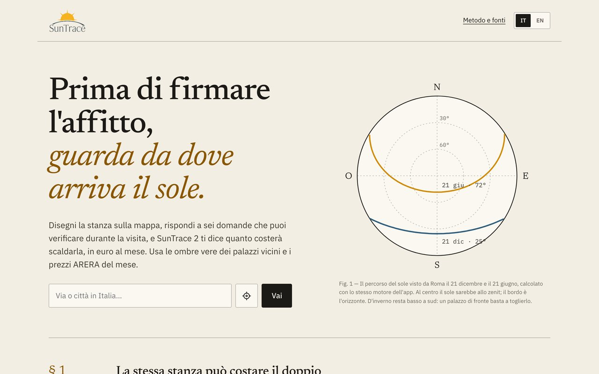

1. Scrivi l'indirizzo della casa e premi **Vai**.
2. Se sei già davanti alla casa, premi il pulsante con il **mirino**: l'app usa la tua posizione.
3. In alto a destra passi dall'**italiano** all'**inglese** (IT / EN).

## 3. La guida alla prima visita

La prima volta che apri l'app, lo schermo si scurisce e un riquadro ambra
cerchia un elemento alla volta, con una scheda che spiega a cosa serve.
Finché la guida è aperta non puoi toccare l'app.

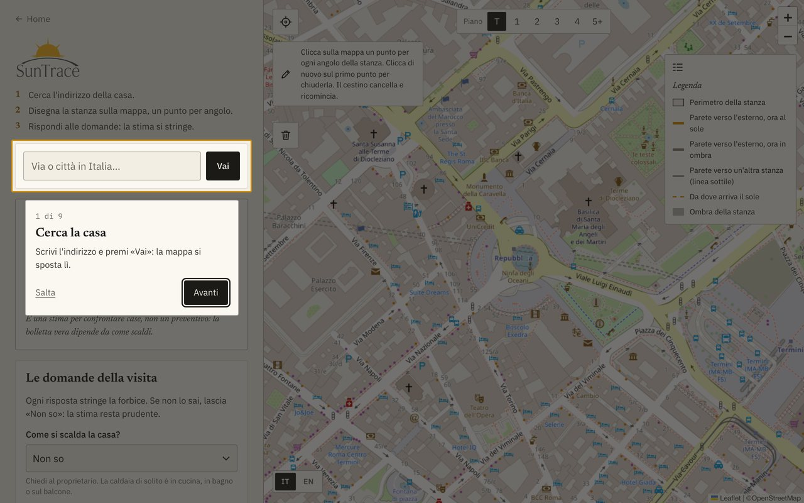

- **Avanti** e **Indietro** scorrono i passi (anche con le frecce della tastiera); **Salta** la chiude.
- Compare una volta sola. Per rivederla, usa il link **Guida** in fondo alla colonna (sul telefono, in fondo al pannello domande).

## 4. Trovare la casa e disegnare la stanza

Scrivi l'indirizzo: dopo tre lettere compaiono i suggerimenti. Clicca quello
giusto e premi **Vai**; la mappa si centra sull'indirizzo. Il tasto **Invio**
chiude solo i suggerimenti.

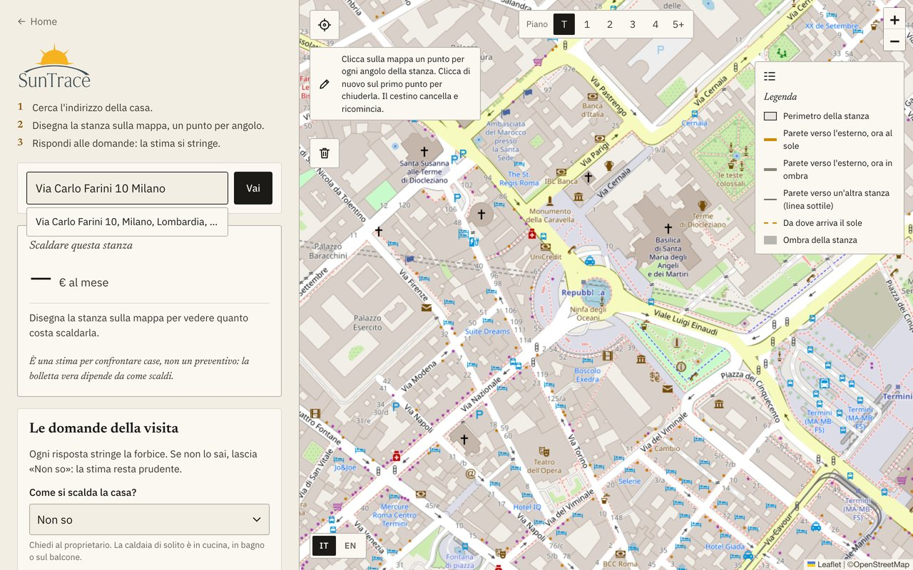

Ingrandisci con il **+** finché vedi bene il palazzo. Sul telefono la mappa
arriva più vicina, per toccare gli angoli con il dito.

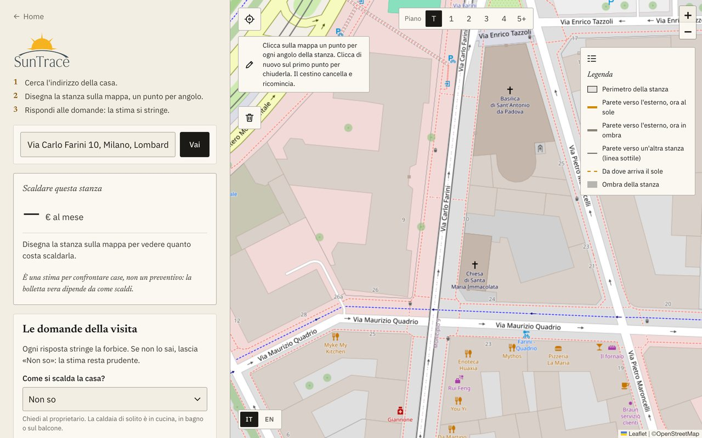

1. Clicca **un punto per ogni angolo** della stanza, girandole intorno in ordine.
2. Per chiuderla, clicca **di nuovo sul primo punto**. Servono almeno tre punti.
3. Nella barra **Piano** in alto scegli a che piano è (T = piano terra, 5+ = quinto o più).
4. Il **cestino** cancella la stanza.

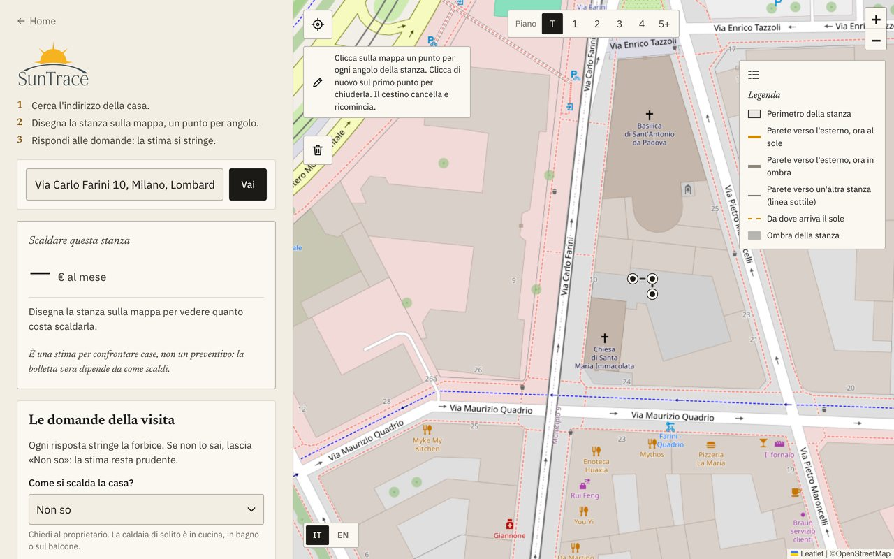

**L'app rifiuta i disegni senza senso**, li cancella e ti dice perché:

- lati che si **incrociano** o stanza sotto i **2 m²**;
- stanza disegnata **sull'acqua** (fiume, lago, mare), con 1,5 m di tolleranza sulla riva;
- stanza **fuori dall'Italia** (Vaticano e San Marino sono accettati).

Se disegni più di 120 m², l'app ti avvisa che probabilmente hai preso più di
una stanza.

## 5. Leggere la stima

Appena chiudi la stanza compare per qualche secondo «Controllo che la stanza
non sia sull'acqua e scarico gli edifici intorno…». Poi la scheda **Scaldare
questa stanza** mostra la stima.

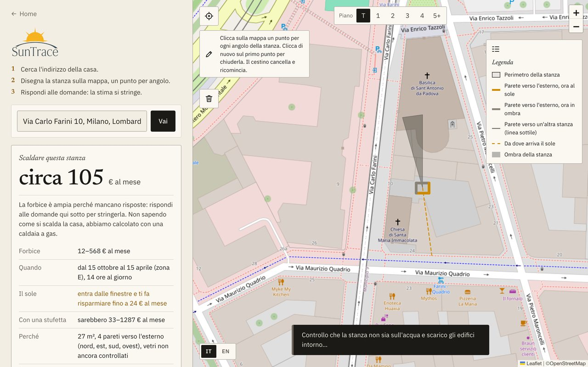

| Riga | Cosa ti dice |
| --- | --- |
| **Circa … € al mese** | La cifra più probabile: valori tipici per tutto quello che non hai ancora detto. |
| **Forbice** | Dal caso migliore al peggiore. Finché manca qualche risposta è ampia, e l'app lo scrive. |
| **Quando** | I mesi e le ore al giorno in cui si scalda, secondo la zona climatica del comune. |
| **A testa** | La quota di ciascuno, se indichi più persone. |
| **Il sole** | Quanto puoi risparmiare al massimo grazie al sole dalle finestre, ombre comprese. |
| **Con una stufetta** | Quanto costerebbe con una stufetta elettrica. |
| **Perché** | Metri quadri, pareti verso l'esterno e verso dove, vetri indicati. |
| **Fonti** | Prezzi ARERA del mese per la tua zona d'Italia e fonte del clima. |

È una stima per **confrontare case**, non un preventivo.

## 6. Rispondere alle domande della visita

Sotto la stima trovi sette domande: cose che puoi **vedere o chiedere durante
la visita**. Ogni risposta rende la stima più precisa; se non sai, lascia
**Non so**.

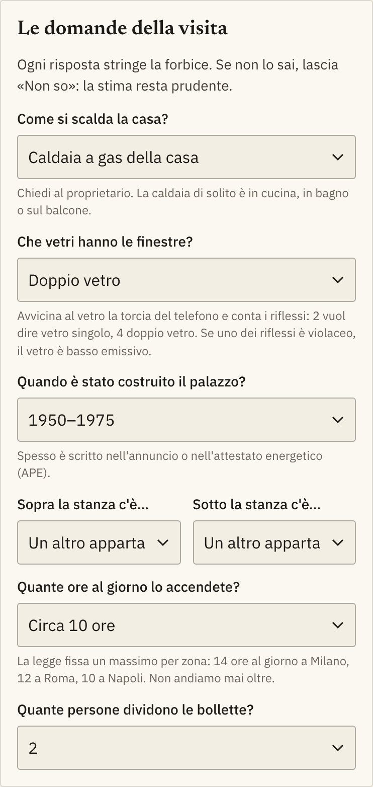

| Domanda | Come lo scopri |
| --- | --- |
| **Come si scalda la casa?** | Chiedi al proprietario. La caldaia di solito è in cucina, in bagno o sul balcone. È la risposta che cambia di più la stima. |
| **Che vetri hanno le finestre?** | Torcia del telefono sul vetro: 2 riflessi = vetro singolo, 4 = doppio. Un riflesso violaceo = basso emissivo. |
| **Quando è stato costruito il palazzo?** | Nell'annuncio o nell'attestato energetico (APE). Nei muri di prima del 1976 non c'è isolante. |
| **Sopra / sotto la stanza c'è…** | Un altro appartamento, oppure tetto o cantina (disperdono di più). |
| **Quante ore al giorno lo accendete?** | Da 4 a 14 ore. La legge fissa un massimo per zona (14 a Milano, 12 a Roma, 10 a Napoli); con «Non so» si usa quello. |
| **Quante persone dividono le bollette?** | Serve per la quota a testa. |

Dopo le risposte la stima si assesta:

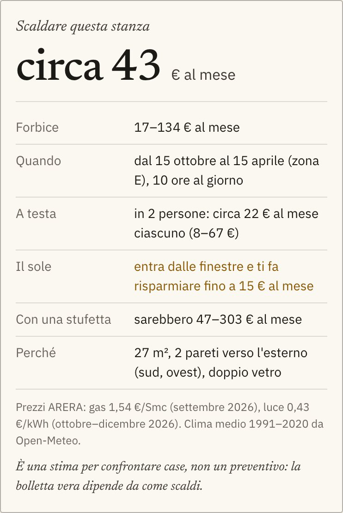

**Riscaldamento centralizzato:** l'app mostra il consumo stimato della stanza,
come con una caldaia a gas. Quanto paghi davvero dipende anche da come il
condominio divide le spese.

## 7. La checklist e la scheda da condividere

**Alla visita: controlla e chiedi** è una lista di massimo cinque punti,
diversa per ogni stanza: per esempio cercare la muffa se la stanza prende poco
sole, o ricordare che la stufetta costa molto più del gas. L'ultima voce è
sempre la classe energetica (APE), che per legge va scritta nell'annuncio.

**Condividi la scheda** copia un link con stanza, piano e risposte. Chi lo apre
vede la stessa stanza e la stessa stima. Dal telefono si apre il menu di
condivisione.

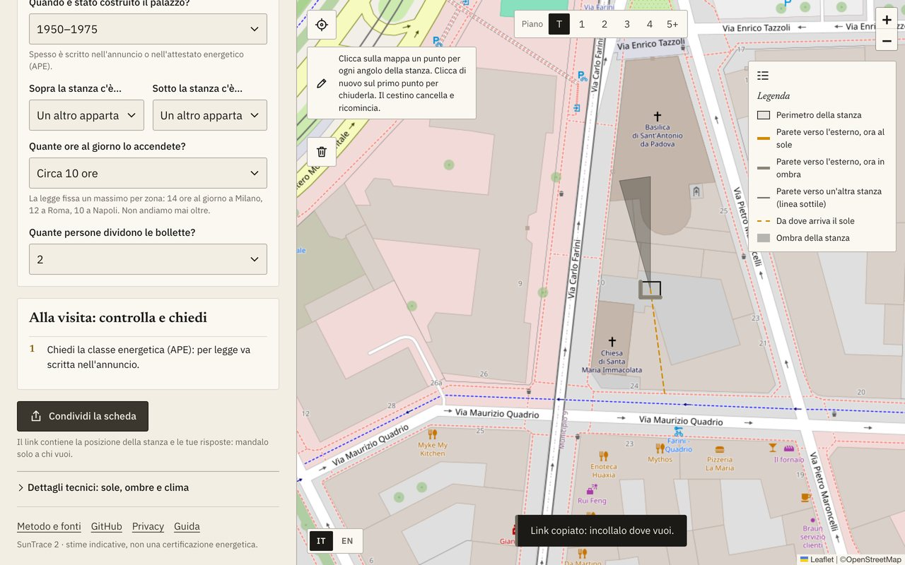

**Privacy:** il link contiene la posizione della stanza e le tue risposte. Non
passa da nessun server: mandalo solo a chi vuoi.

## 8. I dettagli tecnici e la mappa

In fondo alla colonna, **Dettagli tecnici: sole, ombre e clima** si apre con un clic.

- **Mese e Ora** muovono il sole sulla mappa: vedi da dove arriva (tratteggio ambra) e quali pareti sono al sole. La stima non cambia: usa sempre tutta la stagione.
- **Il sole adesso:** alba, tramonto, ore di luce, altezza e direzione del sole, e se le pareti sono al sole o in ombra di un palazzo.
- **Clima del luogo:** la **zona climatica** («di legge» se il comune è nella tabella del DPR 412/93, altrimenti «stimata dal clima»), umidità, vento e pioggia del mese, coordinate e metri quadri.

Esempio: gennaio a mezzogiorno, piano terra. Le pareti a sud e a ovest sono in
ombra del palazzo di fronte; il sole fa risparmiare fino a 15 € al mese.

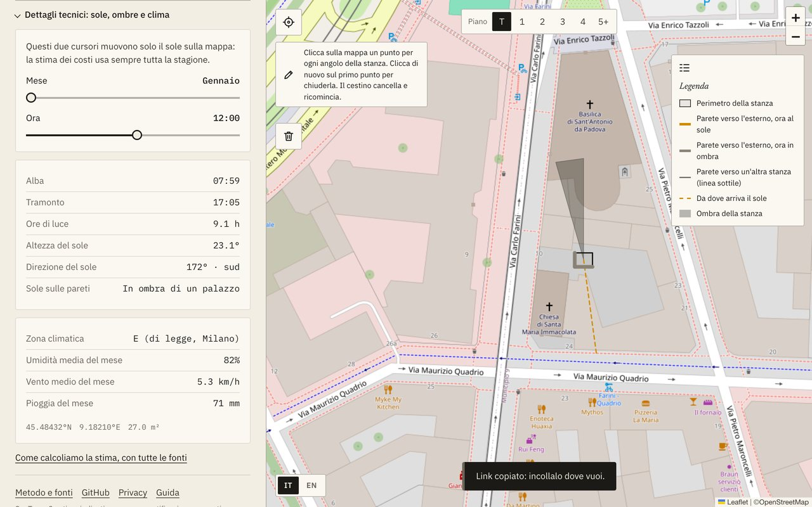

La stessa stanza al **5° piano o più**: più sole supera i tetti di fronte e il
risparmio sale a 19 € al mese.

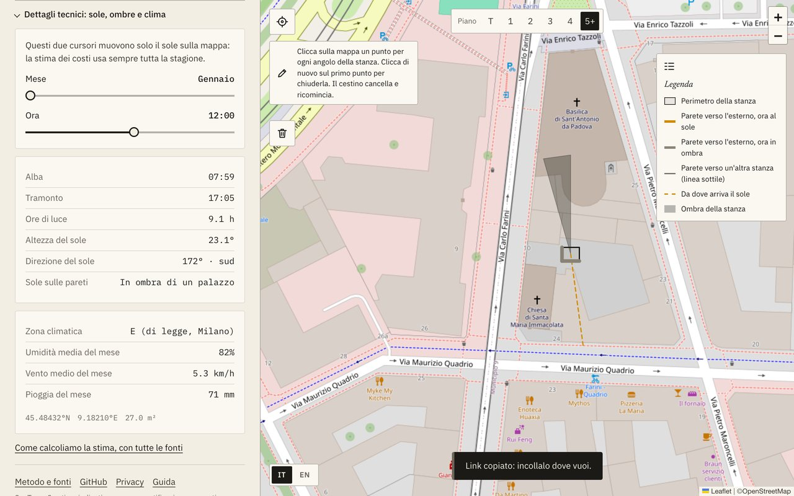

## 9. Dal telefono

Sul telefono la mappa occupa tutto lo schermo e la cifra resta sempre visibile
nella barra in basso.

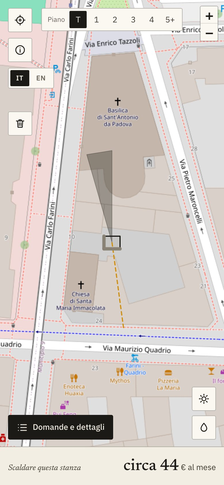

1. Tocca **Domande e dettagli** oppure il costo in basso: si apre il pannello con ricerca, stima, domande, checklist, condivisione, dettagli e il link **Guida**.
2. Il pulsante **i** apre la legenda e il suggerimento per disegnare.
3. Le icone in basso a destra (sole e goccia) aprono i dati del sole e del clima; si chiudono toccando fuori.
4. Il pannello scorre solo in verticale.

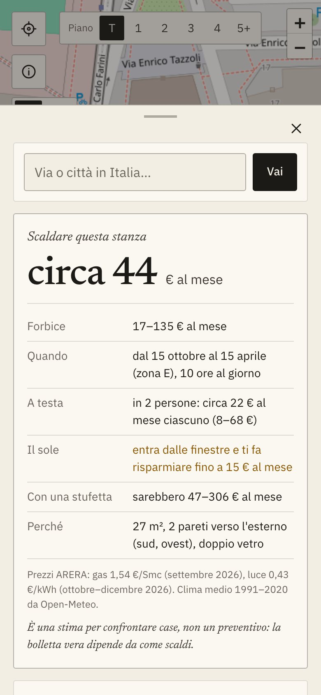

## 10. Domande frequenti e problemi comuni

| Problema o domanda | Cosa fare |
| --- | --- |
| La forbice è molto ampia | Mancano risposte: compila le domande, soprattutto riscaldamento, ore ed epoca del palazzo. Con tutte le risposte resta una forbice: è quello che non si vede (muri, abitudini). |
| La stanza sparisce dopo qualche secondo | Era disegnata sull'acqua, fuori dall'Italia o con i lati incrociati: leggi il messaggio e ridisegnala. |
| Compare «Hai disegnato … m²: è più di una stanza» | Ingrandisci, cancella con il cestino e disegna solo la stanza. |
| «Sto scaricando il clima…» resta a lungo | Il servizio del clima o degli edifici è lento: aspetta o riprova. |
| La zona dice «stimata dal clima» | Il comune non è nella tabella di legge (per esempio un comune nato da una fusione recente): si usa la zona dedotta dal clima. |
| La posizione non funziona | Abilita i servizi di localizzazione del browser, oppure scrivi l'indirizzo. |
| Quanto è precisa la stima? | Non è ancora misurata in percentuale. Ogni valore ha una fonte pubblica, ma il calcolo semplifica (20 °C in casa, niente calore da persone ed elettrodomestici). Usala per **confrontare** stanze. |
| I prezzi sono aggiornati? | Sì: si aggiornano da soli ogni mese dai file ARERA, per zona d'Italia. Il mese usato è scritto sotto la stima. |
| È un attestato energetico? | No. Per la classe energetica ufficiale chiedi l'APE. |

Per i numeri, formula per formula: [Come calcoliamo la stima](../metodo.md).

---

*Le schermate usano edifici simulati intorno a un indirizzo reale di Milano.*
